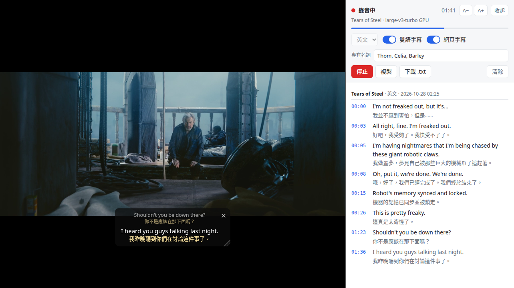

# AI Realtime Speech Extension (Tab Transcriber)

English | [繁體中文](README.zh-TW.md)

A Brave/Chrome extension that turns English, Japanese or Thai audio playing in a browser tab (practice sites, YouTube, Twitch, podcast pages…) into a timestamped transcript with live captions, and can add Traditional Chinese translations underneath:



<sub>Real screenshot (RTX 2060, large-v3-turbo, bilingual captions on). Video shown: *Tears of Steel* © Blender Foundation | [mango.blender.org](https://mango.blender.org), [CC BY 3.0](https://creativecommons.org/licenses/by/3.0/).</sub>

```
[00:00] They must go by the mail, she thought, and how funny it'll seem to send shoes to one's own feet, how odd the address will look.
        她想，他們必須通過郵寄的方式來送東西。把鞋子寄到自己腳邊，會有多有趣啊！而地址的寫法也一定會很奇怪吧。
```

- Speech recognition runs on your own computer with Whisper (faster-whisper); no audio or text is uploaded. With an NVIDIA GPU it uses the large-v3-turbo model; without one it uses the small model on the CPU.
- Live captions: a light-coloured caption at the bottom of the side panel updates about once a second on a GPU (about every 2 seconds on CPU only). When a sentence ends with a pause, it is finalised as a regular line. The first caption takes an extra 2–3 seconds while the model loads.
- On-page captions: a draggable caption box floats over the page being recorded, showing the previous and current sentence, and stays visible in fullscreen video. See [On-page captions](#on-page-captions).
- Bilingual captions: turn on the "雙語字幕" (bilingual captions) switch in the side panel to add a Traditional Chinese translation under each sentence, including the live caption. Translation also runs locally (Tencent Hy-MT2-1.8B) and can be toggled while recording. See [Bilingual captions](#bilingual-captions).
- You still hear the audio while it is being recorded.
- The speech-to-text program only runs while recording and exits when you stop. While recording it uses up to about 1.8 GB of RAM (GPU mode; about 1.3 GB on CPU only). With bilingual captions on, the translation model uses another ~2 GB of video memory and 0.9 GB of RAM, released when you turn the switch off.

The extension's interface is in Traditional Chinese; this README gives the Chinese label next to each English description.

## Requirements

- Windows 10/11 x64, an Apple Silicon Mac (M1 or later) with macOS 14+, or Linux x86-64.
  - The author uses it on Ubuntu (RTX 2060 6 GB).
  - The Windows and macOS versions have so far only been tested on GitHub's test machines (install, transcription and translation on the CPU, no discrete GPU), not yet on users' computers.
- Brave, Chrome, Chromium or Edge (tested on Brave 155).
- An NVIDIA GPU (Windows, Linux) makes it much faster and enables the large-v3-turbo model; without one the small model runs on the CPU, slower and with more mistakes. On a Mac, Whisper runs on the CPU and the translation model uses the Mac's GPU.

## Install (once)

### 1. Install the local speech-to-text program

**Windows**: download **[TabTranscriberSetup.exe](https://github.com/EdwardLeeee/ai-realtime-speech-extension/releases/latest/download/TabTranscriberSetup.exe)**, double-click it and click through the wizard.

- No administrator rights or other software needed (it installs uv, which manages the Python environment, by itself).
- A separate window shows download progress: the Whisper and translation models are 2–5 GB, about 5–15 minutes the first time.
- The installer isn't code-signed, so Windows may show "Windows protected your PC": click "More info" → "Run anyway".
- Uninstall later from Settings → Apps.

**macOS**: open Terminal and paste:

```bash
command -v uv || curl -LsSf https://astral.sh/uv/install.sh | sh   # install uv if missing
git clone https://github.com/EdwardLeeee/ai-realtime-speech-extension.git ~/ai-realtime-speech-extension
~/ai-realtime-speech-extension/install.sh
```

(The first time you use git, macOS asks to install the "command line developer tools"; click Install.)

**Linux**:

```bash
git clone https://github.com/EdwardLeeee/ai-realtime-speech-extension.git
cd ai-realtime-speech-extension
./install.sh
```

Requires [uv](https://docs.astral.sh/uv/) and curl.

This creates the Python environment, downloads the Whisper model and the translation model for bilingual captions (about 2 GB), and registers the local speech-to-text program with Brave and Chrome. If an NVIDIA driver is detected, it also installs the CUDA libraries for the GPU (about 2 GB) and the large-v3-turbo model (about 1.6 GB). If you don't need bilingual captions, run `./install.sh --no-translate` instead (on Windows without the installer: `install.ps1 -NoTranslate`).

Updating: on Windows, run the new installer; on macOS and Linux, `git pull` in the folder and run `install.sh` again. Files that are already downloaded are verified and skipped.

### 2. Load the extension in the browser

1. Open `brave://extensions` in Brave (`chrome://extensions` in Chrome, `edge://extensions` in Edge).
2. Turn on "Developer mode" in the top right.
3. Click "Load unpacked" and choose the `extension` folder in the install folder:
   - Windows: the last page of the installer shows the path and opens the folder (`%LOCALAPPDATA%\Programs\TabTranscriber\extension`).
   - macOS: `~/ai-realtime-speech-extension/extension` (press ⌘⇧G in the file dialog to paste the path).
   - Linux: the `extension` folder in the cloned folder.
4. The extension asks for permission to "read and change all your data on all websites"; it only uses it to put the on-page captions back on the recorded tab after the page changes.
5. Click the puzzle-piece icon in the toolbar and pin **Tab Transcriber**.

## Usage

1. Open the page with the audio and press play.
2. Click the Tab Transcriber icon in the toolbar. The side panel opens on the right and starts recording in the language you used last time (English the first time).
3. If the language is wrong, press "停止" (Stop), pick "英文" (English), "日文" (Japanese) or "泰文" (Thai) in the menu at the top left, then press "開始" (Start). The language is remembered.
4. Press "停止" (Stop) in the side panel when you are done.
5. "複製" (Copy) copies the transcript to the clipboard and "下載 .txt" (Download .txt) saves it as a text file. "清除" (Clear) has to be pressed twice so you don't delete it by accident.

Buttons in the top right of the side panel:

- **A−/A+**: change the transcript font size in the side panel; remembered.
- **收起** (Collapse): closes the side panel without stopping the recording; on-page captions keep showing. Clicking the toolbar icon while recording opens it again; clicking it when not recording starts a recording.

Notes:

- The time in front of each sentence counts **from when recording started**, not the video's own playback time. To line them up, click the icon first and then press play.
- Changing pages in the recorded tab (another YouTube video, another page on the same site, or a different site) does not stop the recording; transcription follows the new page and the on-page captions reappear there. Everything goes into the same transcript, still titled with the page where recording started.
- To start recording a tab you must click the toolbar icon on that tab first (browsers only let extensions capture tabs the user has invoked them on). After that, as long as you stay on the same site, you can stop and press "開始" (Start) in the side panel to record again; after moving to a different site, click the icon again.
- Only one tab is recorded at a time. Clicking the icon on another tab while recording only opens the side panel; press Stop first, then click the icon on the new tab.
- A pause of more than 0.4 seconds in the middle of a sentence occasionally splits it into two lines (e.g. `look through to` / `the garden with one eye.`); the text itself is unaffected.
- With constant background sound (esports casts, crowds, game audio, background music) lines are still split at pauses in speech, so finished lines don't wait for the 25-second maximum.
- Transcripts are stored in the browser and survive closing the side panel or restarting the browser; they are only deleted with "清除" (Clear).
- In videos with a lot of music or singing and little speech, Whisper sometimes produces sentences nobody said; in Japanese a common one is "ご視聴ありがとうございました". This is a known Whisper problem. The program limits how long such output can get: a segment with only a second or two of speech used to stall for about 10 seconds and now takes about 2; segments with more speech can still stall for 4–5 seconds. The phantom sentences can still appear.
- Continuous interjections, backchannels or laughter (e.g. repeated "うん、うん" or "ううう") are written out literally by Whisper. Runs repeated 4 or more times are shortened to 3 plus "…" (e.g. "うん。 うん。 うん。…"), and such repetition no longer triggers re-transcription at six temperatures (which used to stall a segment, and the captions, for 8–16 seconds).

## YouTube captions

- With the "YouTube 字幕" (YouTube captions) switch on in the side panel, clicking the icon on a YouTube video that has captions (CC) uses the player's own captions: nothing is recorded, Whisper doesn't run and the GPU isn't used. Human-made captions are usually more accurate than Whisper; auto-generated ones are YouTube's own quality.
- If CC is off in the player, the extension presses the CC button once for you (the player only loads captions while CC is on) and turns it back off when you stop. If you had CC on yourself, it leaves it alone. If no captions arrive within 10 seconds it tells you; usually the video has no captions. If CC is already on, reload the page or switch the caption language once.
- The extension reads the caption file the player itself loads and never downloads anything else. As soon as it has it, **the whole video's captions** go into the transcript, so you can read, copy or download the parts that haven't played yet. YouTube's Terms of Service don't allow downloading content without authorization; keep it to personal study.
- The time in front of each line is **the video's own time**. The side panel highlights the line playing now and scrolls along with it; if you scroll away yourself it won't pull you back, and it follows again once that line is in view. Seeking back or reloading the page doesn't record the same line twice.
- If you switch the caption language during a recording, that video's lines in the transcript switch to the new language. "清除" (Clear) only removes earlier recordings; this recording's captions stay.
- Bilingual captions still work, translated to Traditional Chinese by the local model; the captions can be in any language. The next ~60 seconds of the video are translated ahead of time, so the Chinese shows up together with the original; after you seek, translation restarts from the new position. Only lines near the playback position get translated, so parts you haven't played stay untranslated in the transcript. Stopping doesn't wait for lines that haven't played yet.
- On sites other than YouTube, or videos without captions (most live streams), it records and uses Whisper as usual.
- So far this has only been verified on a mock YouTube page: in the automated test browser YouTube blocks captions and playback. It hasn't been tested on real YouTube yet (including turning CC on automatically), and YouTube changes could break it.
- YouTube's own CC still shows on the video, together with the extension's caption box.

## Proper nouns

- Put names Whisper keeps getting wrong (people, teams, terms) into the "專有名詞" (proper nouns) field in the side panel, separated by commas, e.g. `donk, MOUZ, torzsi, Five-SeveN`, and Whisper will spell them that way.
- The list is remembered separately for each language. Changing it while recording applies from the next sentence.
- Measured on 4 minutes of an English Twitch PGL broadcast: with both teams' players, team names and weapon names filled in, large-v3-turbo got the names right in 15 places instead of 3; `large-v3` with the list got all 24 right (see [Changing models](#changing-models); large-v3 can't be used together with bilingual captions).
- Up to about 30 English names; anything beyond that is ignored.

## On-page captions

- While the "網頁字幕" (on-page captions) switch in the side panel is on (the default), a caption box floats over the page being recorded: the dimmer line on top is the previous sentence, the one below is the sentence being spoken. With bilingual captions on, each sentence has its Chinese translation underneath.
- Drag the box to move it anywhere; the position is remembered.
- Drag the diagonal grip in any corner to change its width and height (the opposite corner stays put) without changing the text size: wider fits more words per line, taller shows more lines (text sticks to the bottom). The size is remembered and scales up with the text in fullscreen; double-click any corner to go back to automatic sizing. The bottom-right grip is always visible; the other three appear when the mouse is over the box. When not resized, a very long sentence shows only its latest ~5 lines.
- The × in the top-right corner closes the box and turns off the "網頁字幕" switch, so later recordings won't show it either; turn the switch back on to see it again, also while recording.
- The caption box stays on top in fullscreen video. When a site puts its whole player into fullscreen, you can still drag, resize and close it. If only the video element itself goes fullscreen (for example the fullscreen button of the browser's built-in player, with the browser's playback controls at the bottom), or the player is built in a way the box can't be placed inside, you can see the captions but can't drag, resize or close them until you exit fullscreen.
- The box is only added to the recorded tab, reappears after page changes (except internal pages such as brave://), and is removed when recording stops.
- The font size follows the page width and is larger in fullscreen.

## Bilingual captions

- Turn on the "雙語字幕" (bilingual captions) switch in the side panel to translate the original into Traditional Chinese under each sentence; the live caption gets a translated line too. The switch is remembered and can be toggled while recording.
- The translation model loads when you first turn it on; "載入翻譯模型…" (loading translation model) shows next to the switch for about 2–5 seconds. After that, a translation appears about 0.5–1 seconds after each sentence is finalised, and the live caption's translation lags the original by under a second.
- English and Japanese are translated once a sentence ends (. ? ! 。), so the translation appears under the last line of the sentence. Lines ending in a comma wait, so half sentences aren't translated. Thai hardly uses punctuation, so each line is translated on its own; when a sentence is split into two lines, the two translations may not read smoothly.
- Only sentences after the switch is turned on are translated; earlier ones are not back-filled. With the switch off, the screen, Copy and Download show only the original; translations already made are kept and reappear when you turn it back on.
- On CPU only, live captions are not translated (about 3 seconds per sentence can't keep up with once-a-second updates); only finalised lines are.
- The translator is a small 1.8B model and makes mistakes, occasionally reversing the meaning. Examples seen in testing: Thai "unlikely to be prosecuted" translated as "may be prosecuted", Japanese "モズ" (shrike) as "owl", and the name "ゴン" as "戈恩" or "岡". Treat translations as a reference.
- Recognition errors in the original carry over into the translation.

## Changing models

To change models, create `~/.config/tab-transcriber/config.json` (Windows: `%USERPROFILE%\.config\tab-transcriber\config.json`) with only the parts you want to change. `gpu_models` is used with a GPU and `models` on CPU only:

```json
{ "gpu_models": { "en": "medium.en" }, "models": { "ja": "medium" } }
```

Speed measured on the author's machine (RTX 2060 / 12-thread CPU):

| Model | Runs on | Time to transcribe 60 s | Time per live-caption update | Notes |
|---|---|---|---|---|
| `large-v3-turbo` (default with a GPU) | GPU | ~1.9 s | 0.3–0.4 s | Most accurate for English and Japanese |
| `small.en` / `small` | GPU | ~1.5 s | 0.1–0.4 s | Faster, more mistakes |
| `medium.en` / `medium` | GPU | ~4 s | not measured | Japanese sometimes repeats the last sentence |
| `small.en` (CPU-only default, English) | CPU | ~10 s | 1.3–2.1 s | Captions update about every 2 seconds |
| `small` (CPU-only default, Japanese) | CPU | ~12 s | not measured | Some mistakes, e.g. "穴から**はい出ました**" (crawled out of the hole) became "穴から入れました" (put into the hole) |

Thai character error rate on 40 sentences from Google FLEURS (lower is better):

| Model | Runs on | Character error rate | Time to transcribe 60 s | Notes |
|---|---|---|---|---|
| `large-v3-turbo` (default with a GPU) | GPU | 12.3% | ~3.5 s | Mostly spelling, e.g. mixing up ร/ล ("ดังกล่าว" → "ดังกราว") |
| `large-v3` | GPU | 8.3% | ~10 s | Most accurate, but live captions get slower; ~3.8 GB of video memory (turbo ~2.2 GB), more than 6 GB with bilingual captions |
| `medium` | GPU | 14.2% | ~8 s | Slower than turbo and no more accurate |
| `small` (CPU-only default) | CPU | 19.1% | ~21 s | Many mistakes |

For more accurate Thai, put `{ "gpu_models": { "th": "large-v3" } }` in the config file.

Changes take effect the next time you press Start. A new model is downloaded the first time it is used.

The translation model can be changed too: set `"translate_model"` to the full path of a GGUF file. For example, the Q4_K_M build of Hy-MT2-1.8B cuts video memory from ~1.9 GB to 1.2 GB but makes more mistakes ("small key" became "小鎖" (small lock), "midterm" became "中期考試").

## Troubleshooting

| Message | What to do |
|---|---|
| 找不到本機轉文字程式 (local speech-to-text program not found) | Run `install.sh` once, then press Start |
| 請切到要轉文字的分頁，點工具列上的圖示 (switch to the tab to transcribe and click the toolbar icon) | Go back to the tab playing the audio and click the toolbar icon (not Start in the side panel) |
| 本機轉文字程式意外結束 (local speech-to-text program exited unexpectedly) | Check the last lines of `~/.cache/tab-transcriber/host.log` (Windows: `%USERPROFILE%\.cache\tab-transcriber\host.log`) |
| 翻譯模型還沒安裝 (translation model not installed) | Run `install.sh` once (without `--no-translate`), then turn on bilingual captions |
| 翻譯模型啟動失敗 (translation model failed to start) | Check the last lines of `~/.cache/tab-transcriber/llama-server.log` |

## Uninstall

1. Remove Tab Transcriber in `brave://extensions`.
2. Windows: uninstall Tab Transcriber from Settings → Apps. macOS and Linux: run `./uninstall.sh` in the folder (removes the registration files).
3. If you no longer need them, delete this folder, `~/.cache/tab-transcriber` (translation model and logs), and the `faster-whisper` models in `~/.cache/huggingface/hub`.

## Development

```
extension/   The extension (Manifest V3)
  background.js   Recording flow: tabCapture → offscreen recorder → local program → storage
  offscreen.js    Captures tab audio, plays it back, resamples to 16 kHz, splits at pauses
  pcm-worklet.js  AudioWorklet that hands over a 100 ms block of audio at a time
  sidepanel.*     Side panel
  caption-overlay.js  On-page captions: injected into the recorded tab, re-injected after page loads (hence the all-sites permission)
host/        Local speech-to-text program (native messaging host, Python + faster-whisper, managed with uv)
  vendor/llama.cpp/  llama.cpp (Vulkan build) downloaded by install.sh; runs the translation model via llama-server; not in git
tests/e2e.mjs  End-to-end test: headless Brave loads the extension, plays audio, simulates the icon click, checks transcript and bilingual captions
tests/test_repeats.py  Unit tests for shortening repeats and detecting interjections in the local program (no model needed)
tests/test_hints.py  Rules for putting proper nouns into the Whisper prompt (tokenizer only)
tests/test_caption_queue.py  Translation queue for YouTube captions mode (no translation model started)
tests/test_chunking.mjs  Unit test for where the recorder splits audio, including with constant background sound (no browser or model needed)
tests/test_native_host.py  Starts the local program from its registration like a browser would and exchanges messages (Linux and Windows; GitHub Actions runs it on Windows)
tests/e2e_youtube_cc.mjs  YouTube captions mode on a mock YouTube watch page: CC turned on automatically, whole video in the transcript, follows video time, no duplicates, no recording
install.sh     Install for Linux and macOS; install.ps1 is the Windows one (install.cmd runs it on double-click)
installer/TabTranscriber.iss  Windows installer (Inno Setup): copies files, then runs install.ps1; built by GitHub Actions and attached to the Release on v* tags
.github/workflows/install.yml  Linux unit tests plus macOS and Windows install tests (Windows builds Setup.exe and installs it silently)
docs/research/ Research notes and measurements (in Chinese)
```

Tests (run `install.sh` first):

```bash
C=docs/research/tab-transcription/corpus
node tests/e2e.mjs --audio $C/alice-one-syllable-ch02.mp3 --start 60 --duration 60 --bilingual toggle
node tests/e2e.mjs --audio $C/gongitsune-01.mp3 --start 60 --duration 40 --lang ja --bilingual on
node tests/e2e.mjs --audio $C/fleurs-th-dev.mp3 --start 0 --duration 84 --lang th --bilingual on
host/.venv/bin/python -m unittest tests/test_repeats.py
host/.venv/bin/python -m unittest tests/test_hints.py
host/.venv/bin/python -m unittest tests/test_caption_queue.py
node tests/test_chunking.mjs
node tests/e2e_youtube_cc.mjs
host/.venv/bin/python tests/test_native_host.py   # Windows: host\.venv\Scripts\python.exe tests\test_native_host.py
```

The extension ID is fixed at `pclblnfmncjbohcnbhlkgefpdhpljiae` (set by `key` in `manifest.json`); the registration file written by `install.sh` only allows this ID to connect.

Test audio sources and licences are listed in [docs/research/tab-transcription/corpus/SOURCES.md](docs/research/tab-transcription/corpus/SOURCES.md).
